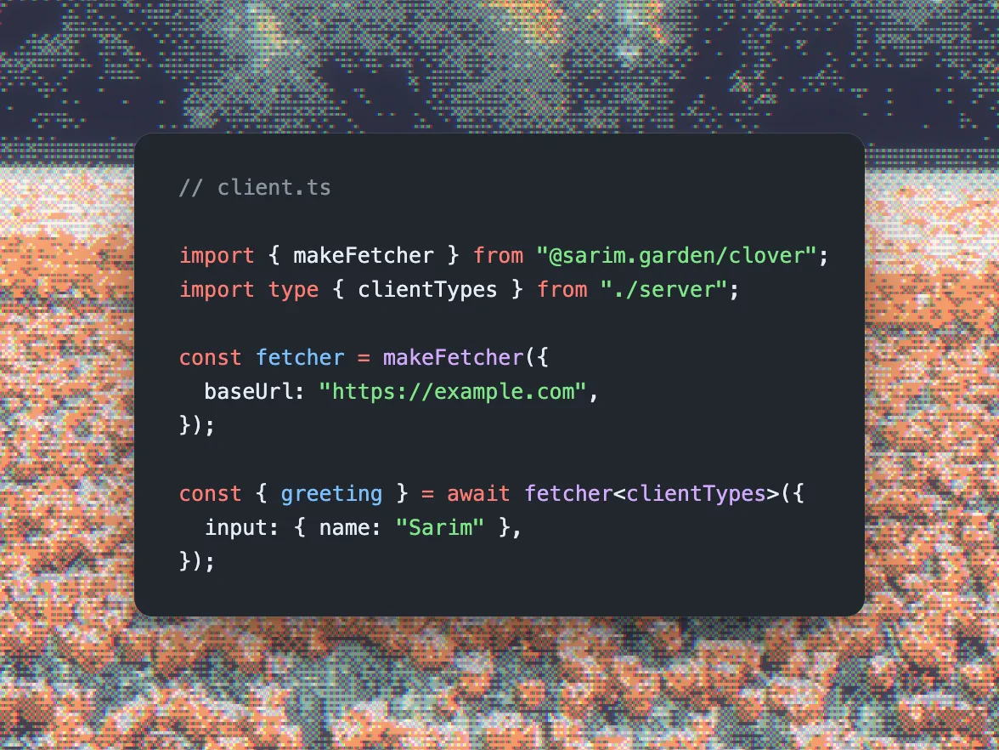

# Clover

Server routes augmented with Zod and OpenAPI



## Installation

```bash
pnpm add @sarim.garden/clover
```

Or use `npm` or `yarn`.

## Docs

You can find the latest documentation on https://clover.lil.run

